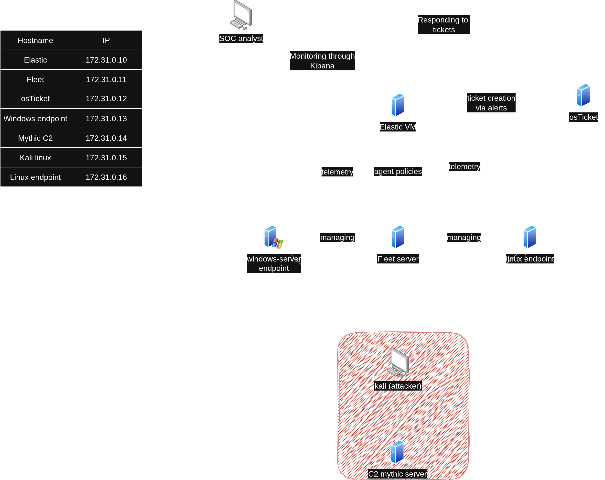

---

### overview

Threat detection & adversary emulation lab
End to end, locally hosted threat emulation + SOC managing and detection homelab. 

### tech stack

- Hypervisor: kvm/qemu with virt-manager interface. hosting on fedora with 32GB ram.
- SIEM: Elastic + Kibana
- Ticketing: osTicket (webhook integration)
- Targets (agents managed through fleet): 
	- windows server 2022 with rdp
	- ubuntu 22.04 with ssh 
- Attacker emulation stack: 
	- kali vm
	- mythic C2 (apollo agent)

### homelab layout

| Hostname           | OS                  | Role                   | Telemetry Agent(s)                        | vCPU | RAM  | IP            |
| :----------------- | :------------------ | :--------------------- | :---------------------------------------- | :--- | :--- | :------------ |
| **elk-vm**         | Ubuntu 22.04        | Elasticsearch & Kibana | -                                         | 2    | 6 GB | `172.31.0.10` |
| **fleet-server**   | Ubuntu 22.04        | Fleet Server           | (manages agents)                          | 2    | 2 GB | `172.31.0.11` |
| **osTicket-vm**    | Windows Server 2022 | osTicket Service       | -                                         | 2    | 4 GB | `172.31.0.12` |
| **windows-target** | Windows Server 2022 | Endpoint Target        | Elastic Agent + Sysmon + Windows-defender | 2    | 4 GB | `172.31.0.13` |
| **Mythic**         | Ubuntu 22.04        | Mythic C2 Server       | -                                         | 2    | 4 GB | `172.31.0.14` |
| **kali-linux**     | Kali Linux          | Adversary Emulation    | -                                         | 2    | 4 GB | `172.31.0.15` |
| **ubuntu-target**  | Ubuntu 22.04        | Endpoint target        | Elastic Agent + osQuery + Elastic Defend  | 2    | 2 GB | `172.31.0.16` |

---
#### telemetry ingestion and agent management
The endpoints (windows server 2022 and ubuntu machines) collect telemetry via the elastic agents installed on them. 
These agents are managed through fleet, which allows to make general changes without going one by one.
There are 2 policies:
- Windows policy: elastic agent + sysmon + windows-defender
- Linux policy: elastic agent + Osquery + Elastic Defend

This telemetry gets sent to the elastic service, and seen through kibana. This will be used to not only monitor but also create automated alerts to detect possible attacks / respond to them.

#### ticketing
To manage and prioritize alerts among analysys, Elastic alerts can be configured to create tickets on other services. I will use osTicket, but alternatives are Jira, Zendesk, etc.

### offense

To emulate an attacker im using a kali vm and a mythic c2 server with the apollo agent. The goal is to gain initial access, bypass/disable defenses, and for post-exploitation download and execute a payload so it beacons to the c2 server.
On the second case, instead of a C2 server, a more crude approach will be demonstrated, with a reverse shell and persistence through cron.

---
## Scenarios

###  01 RDP BRUTEFORCE ATTACK + Defense bypass

1. Initial access through RDP bruteforcing
2. Windows defender RTP disabling + payload staging
3. C2 beaconing + recon from C2 server
4. Alerts + tickets used to detect this attack
5. Correlating attacker's actions, making timeline
6. Remediation steps + hardening
[01-RDP-bruteforcing-attack](01-RDP-bruteforcing-attack.md)

### 02 ssh bruteforcing + persistence

1. Initial access through SSH bruteforcing.
2. Persistence through cron and a reverse shell.
3. Alerts + tickets created to detect this
4. Investigation + removing artifacts
5. Remediation steps + hardening
[02-SSH-breach-persistence](02-SSH-breach-persistence.md)

---

Acknowledgments:
Architecture inspired by the MyDFIR SOC lab. Expanded with more complex and real-world like alerts, more telemetry, attack simulations, remediation steps, hardening, etc...

---
